<h1 align="center">CRF Sequence Labeler</h1>

<p align="center">
  <em>A linear-chain conditional random field for sequence labeling, built from scratch: forward-backward training with log-likelihood gradients, Viterbi decoding, and span-level evaluation.</em>
</p>

<p align="center">
  <a href="https://github.com/adeoluo/crf-sequence-labeler/actions/workflows/ci.yml"></a>
  <a href="https://github.com/adeoluo/crf-sequence-labeler/releases"></a>
  
  <a href="LICENSE"></a>
</p>

---

## Motivation

Many natural-language tasks are sequence labeling: named-entity recognition, part-of-speech
tagging, chunking. The right model is not an independent classifier per token but one that
scores a whole label sequence jointly, so that label transitions (a location tag rarely
follows a person tag mid-word) are learned. The **linear-chain conditional random field** is
that model. This project implements it **from scratch** - the features, **Viterbi**
decoding, **forward-backward** inference, and **log-likelihood gradient** training - with
no automatic differentiation. The only numerical helper is a log-sum-exp function.

## Architecture

<p align="center">
  
</p>

<sub>Legend: amber = entry points and external systems, indigo = core logic, green = data and state, blue = validation and control, grey = observability and outputs.</sub>

The CLI and the HTTP service both train the CRF on the BIO training split before use. Each
token yields transparent **emission features** (word, shape, affixes, neighbors). The CRF
learns a weight per (feature, label) and per (previous label, label). Training ascends the
conditional log-likelihood using forward-backward marginals, with an L2 penalty set in
`TrainingConfig`. At request time the service validates the token list, Viterbi decodes the
best label path, and the BIO tags are turned into entity spans; the same spans feed the
span-level evaluation, and every route records latency and errors for `/metrics`. See the
[ADRs](docs/adr/) for the key decisions.

### The three algorithms

- **Viterbi** - dynamic programming for the single most probable label sequence (decoding).
- **Forward-backward** - computes the log partition function and the node and edge marginals,
  the expectations the gradient needs.
- **Log-likelihood gradient** - the gradient for each sentence is **empirical feature counts
  (from the gold labels) minus expected feature counts (under the model)**, applied by
  stochastic gradient ascent with an L2 penalty. All three run in log space for stability.

### Components

- **features** - transparent emission features per token.
- **crf** - Viterbi decoding, forward-backward inference, and the log partition function.
- **training** - log-likelihood gradient ascent with L2.
- **data** - a BIO named-entity dataset with disjoint splits.
- **evaluation** - span extraction and span-level precision, recall, and F1.

## Results

> Reproduce with `python -m crf_sequence_labeler evaluate`. Span-level scoring: a predicted
> entity is correct only if its type and exact token boundaries match a gold entity.

| Metric | Value |
|---|---:|
| **span-level F1** | **0.857** |
| precision | 0.818 |
| recall | 0.900 |

On held-out sentences the from-scratch CRF reaches **0.857 span F1**, tagging unseen names
and locations correctly - it generalizes through shape and affix features rather than
memorizing words.

### Scale

`benchmarks/scale.py` trains the CRF once, then runs Viterbi decoding over progressively
larger sets of synthetic templated BIO sentences and records wall-clock time, decoding
throughput, peak memory (`tracemalloc`), and span F1. Timing is measured without tracemalloc
(which slows every allocation); peak memory is traced separately around the workload plus a
single decode, which is faithful because decoding processes one sentence at a time.
Throughput is roughly flat near 2,500 to 3,000 sentences per second and peak memory grows
linearly with the number of sentences. Run with `uv run python benchmarks/scale.py`.

| Sentences | Seconds | Throughput (sent/sec) | Peak memory (MiB) | Span F1 |
|---:|---:|---:|---:|---:|
| 2000 | 0.65 | 3068.4 | 0.51 | 0.927 |
| 4000 | 1.52 | 2630.1 | 0.91 | 0.929 |
| 8000 | 3.25 | 2458.9 | 1.92 | 0.932 |
| 16000 | 5.96 | 2684.0 | 3.95 | 0.933 |

Honest caveat: the sentences are synthetic and templated, and this Python implementation
is not benchmarked against compiled sequence-labeling libraries.

## Quickstart

```bash
git clone https://github.com/adeoluo/crf-sequence-labeler.git && cd crf-sequence-labeler
make setup                    # install dev tooling + pre-commit hooks
make all                      # lint + type-check + test

python -m crf_sequence_labeler evaluate                       # span-level F1 on held-out data
python -m crf_sequence_labeler tag Alice lives in Paris       # tag a sentence
```

Train on your own labeled data:

```python
from crf_sequence_labeler import Trainer, TrainingConfig

data = [(["John", "runs"], ["B-PER", "O"]), ...]  # (tokens, BIO tags)
crf = Trainer(["O", "B-PER", "I-PER"], TrainingConfig(epochs=25)).train(data)
print(crf.viterbi(["Mary", "sleeps"]))
```

## Usage

### Demonstration

```text
$ python -m crf_sequence_labeler tag Oscar lives in Vienna
Prediction:
  Oscar          B-PER
  lives          O
  in             O
  Vienna         B-LOC
```

Neither "Oscar" nor "Vienna" appears in the training data; the model infers the tags from
capitalization, affixes, and the cue word "in".

### HTTP service

A standard-library HTTP service trains the CRF once at startup and tags sentences:

```bash
python -m crf_sequence_labeler serve --port 8000

curl localhost:8000/health
curl -s -X POST localhost:8000/tag -d '{"tokens": ["Alice", "lives", "in", "Paris"]}'
curl localhost:8000/evaluate
```

See the [operations guide](docs/OPERATIONS.md) for the service contract and constraints.
The service also exposes `GET /ready` (readiness) and `GET /metrics` (per-route request,
error, and latency metrics in Prometheus text format). A production-style stress benchmark
(`uv run python benchmarks/stress.py`) reports throughput and p50/p95/p99 latency; the
scaling path and tradeoffs are in [docs/SCALING.md](docs/SCALING.md) and a full walk-through
is in the [case study](docs/CASE_STUDY.md).

## Design decisions

- **A conditional random field, not independent classifiers.** Scoring the whole sequence
  lets the model learn transition structure a per-token classifier cannot.
  ([ADR-0002](docs/adr/0002-conditional-random-field.md))
- **Hand-derived log-likelihood gradients.** The gradient is empirical minus expected counts
  from forward-backward, applied directly, keeping the training mathematics explicit and
  transparent. ([ADR-0003](docs/adr/0003-forward-backward-gradient.md))

## Testing

```bash
make test                     # or: uv run pytest
uv run pytest --cov=src --cov-report=term-missing --cov-fail-under=80
```

The suite in `tests/` is seeded and deterministic:

- `test_core.py`: emission features (context and shape), log-sum-exp against a reference,
  the partition function bounding the gold sequence score, learning a simple pattern, empty
  sentences in decoding and training, reproducible seeded training order, and training
  config validation.
- `test_evaluation.py`: BIO span extraction (including entities at sentence boundaries),
  generalization on held-out spans, tagging an unseen sentence, and the CLI commands.
- `test_service.py`: the HTTP handler layer (`/health`, `/ready`, `/tag`, `/evaluate`,
  `/metrics`, token validation, unknown routes).

CI (`.github/workflows/ci.yml`) runs `ruff format --check`, `ruff check`, `mypy src`, and
`pytest` with an 80% coverage gate on Python 3.11 and 3.12, then builds the package and the
Docker image.

## Responsible AI

- **Model card:** [docs/MODEL_CARD.md](docs/MODEL_CARD.md)
- **Data card:** [docs/DATA_CARD.md](docs/DATA_CARD.md)
- **Threat model:** [docs/THREAT_MODEL.md](docs/THREAT_MODEL.md)

## Limitations

- Features are hand-designed; a neural feature extractor would raise accuracy at the cost of
  dependencies and transparency.
- Training runs in interpreted Python, suited to learning and modest datasets, not web-scale corpora.
- The label set and entity types are illustrative.

## Roadmap

- [ ] L-BFGS batch training alongside stochastic gradient ascent
- [ ] Gazetteer and word-cluster features
- [ ] A larger annotated dataset and part-of-speech tagging

## License

Released under the [MIT License](LICENSE).
