<h1 align="center">CRF Sequence Labeler</h1>

<p align="center">
  <em>A linear-chain conditional random field for sequence labeling, built from scratch: forward-backward training with log-likelihood gradients, Viterbi decoding, and span-level evaluation.</em>
</p>

<p align="center">
  <a href="https://github.com/adeoluo/crf-sequence-labeler/actions/workflows/ci.yml"></a>
  
  
  
  
  
</p>

---

## Motivation

Many natural-language tasks are sequence labeling: named-entity recognition, part-of-speech
tagging, chunking. The right model is not an independent classifier per token but one that
scores a whole label sequence jointly, so that label transitions (a location tag rarely
follows a person tag mid-word) are learned. The **linear-chain conditional random field** is
that model. This project implements it **from scratch** - the features, **Viterbi**
decoding, **forward-backward** inference, and **log-likelihood gradient** training - with
**zero runtime dependencies** and no automatic differentiation. The only numerics are a
log-sum-exp helper.

## Architecture

<p align="center">
  
</p>

Each token yields transparent **emission features** (word, shape, affixes, neighbors). The
CRF learns a weight per (feature, label) and per (previous label, label). Training ascends
the conditional log-likelihood using forward-backward marginals; decoding uses Viterbi. See
the [ADRs](docs/adr/) for the key decisions.

## The three algorithms

- **Viterbi** - dynamic programming for the single most probable label sequence (decoding).
- **Forward-backward** - computes the log partition function and the node and edge marginals,
  the expectations the gradient needs.
- **Log-likelihood gradient** - the gradient for each sentence is **empirical feature counts
  (from the gold labels) minus expected feature counts (under the model)**, applied by
  stochastic gradient ascent with an L2 penalty. All three run in log space for stability.

## Results

> Reproduce with `python -m crf_sequence_labeler evaluate`. Span-level scoring: a predicted
> entity is correct only if its type and exact token boundaries match a gold entity.

| Metric | Value |
|---|---:|
| **span-level F1** | **0.857** |
| precision | 0.818 |
| recall | 0.900 |

On held-out sentences the from-scratch CRF reaches **0.857 span F1**, tagging unseen names
and locations correctly - it generalizes through shape and affix features rather than
memorizing words.

## Demonstration

```text
$ python -m crf_sequence_labeler tag Oscar lives in Vienna
Prediction:
  Oscar          B-PER
  lives          O
  in             O
  Vienna         B-LOC
```

Neither "Oscar" nor "Vienna" appears in the training data; the model infers the tags from
capitalization, affixes, and the cue word "in".

## Quickstart

```bash
git clone https://github.com/adeoluo/crf-sequence-labeler.git && cd crf-sequence-labeler
make setup                    # install dev tooling + pre-commit hooks
make all                      # lint + type-check + test

python -m crf_sequence_labeler evaluate                       # span-level F1 on held-out data
python -m crf_sequence_labeler tag Alice lives in Paris       # tag a sentence
```

Train on your own labeled data:

```python
from crf_sequence_labeler import Trainer, TrainingConfig

data = [(["John", "runs"], ["B-PER", "O"]), ...]  # (tokens, BIO tags)
crf = Trainer(["O", "B-PER", "I-PER"], TrainingConfig(epochs=25)).train(data)
print(crf.viterbi(["Mary", "sleeps"]))
```

## Running the service

A dependency-free HTTP service trains the CRF once at startup and tags sentences:

```bash
python -m crf_sequence_labeler serve --port 8000

curl localhost:8000/health
curl -s -X POST localhost:8000/tag -d '{"tokens": ["Alice", "lives", "in", "Paris"]}'
curl localhost:8000/evaluate
```

See the [operations guide](docs/OPERATIONS.md) for the service contract and constraints.
The service also exposes `GET /ready` (readiness) and `GET /metrics` (per-route request,
error, and latency metrics in Prometheus text format). A production-style stress benchmark
(`uv run python benchmarks/stress.py`) reports throughput and p50/p95/p99 latency; the
scaling path and tradeoffs are in [docs/SCALING.md](docs/SCALING.md) and a full walk-through
is in the [case study](docs/CASE_STUDY.md).

## Components

- **features** - transparent emission features per token.
- **crf** - Viterbi decoding, forward-backward inference, and the log partition function.
- **training** - log-likelihood gradient ascent with L2.
- **data** - a BIO named-entity dataset with disjoint splits.
- **evaluation** - span extraction and span-level precision, recall, and F1.

## Design decisions

- **A conditional random field, not independent classifiers.** Scoring the whole sequence
  lets the model learn transition structure a per-token classifier cannot.
  ([ADR-0002](docs/adr/0002-conditional-random-field.md))
- **Hand-derived log-likelihood gradients.** The gradient is empirical minus expected counts
  from forward-backward, applied directly, keeping the project dependency-free and
  transparent. ([ADR-0003](docs/adr/0003-forward-backward-gradient.md))

## Responsible AI

- **Model card:** [docs/MODEL_CARD.md](docs/MODEL_CARD.md)
- **Data card:** [docs/DATA_CARD.md](docs/DATA_CARD.md)
- **Threat model:** [docs/THREAT_MODEL.md](docs/THREAT_MODEL.md)

## Limitations

- Features are hand-designed; a neural feature extractor would raise accuracy at the cost of
  dependencies and transparency.
- Training is pure Python, suited to learning and modest datasets, not web-scale corpora.
- The label set and entity types are illustrative.

## Roadmap

- [ ] L-BFGS batch training alongside stochastic gradient ascent
- [ ] Gazetteer and word-cluster features
- [ ] A larger annotated dataset and part-of-speech tagging

## License

[MIT](LICENSE). Part of an artificial intelligence engineering portfolio by
[adeoluo](https://github.com/adeoluo).
